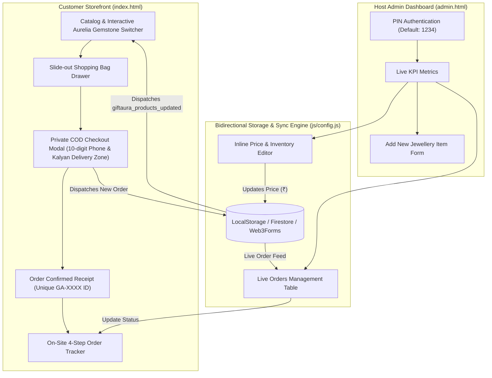

# GiftAura (@gifts.aura_) — Dainty Jewellery & Curated Gifting E-Commerce Platform

> **A Recruiter-Ready Freelance Case Study & Production Web Application**  
> **Client:** GiftAura (`@gifts.aura_`)  
> **Location:** Kalyan & Dombivli, Maharashtra, India  
> **Target Audience:** Young women (Ages 16–28) seeking aesthetic, affordable, anti-tarnish jewellery & curated gifting keepsakes.

---

## 🌟 Executive Summary

**GiftAura** is an emerging boutique jewellery and gifting startup founded in Kalyan, Maharashtra. The brand crafts aesthetic, 18K gold-plated crystal bracelets, snake-chain pendant necklaces, and personalized gifting packages. 

This project delivers a **mobile-first, production-ready, zero-backend e-commerce web platform** featuring an interactive gemstone variant switcher, private Cash-on-Delivery (COD) checkout, customer order tracking, and a password-protected Host Admin Dashboard with an **Instant Inline Price Editor**.

---

## 🎯 The Core Business Challenges

### 1. Absolute Founder Privacy
* **The Risk:** In typical small Indian D2C stores, founders often post their personal WhatsApp numbers or personal UPI IDs directly on Instagram or simple landing pages. This invites spam calls, unsolicited messages, and privacy risks for female entrepreneurs.
* **The Requirement:** The store owner mandated that **no personal phone number, WhatsApp number, or UPI ID be exposed anywhere on the public website**.

### 2. High Drop-off & Chaos in Instagram DMs
* Managing orders, address collection, and payment screenshots via manual Instagram DMs was chaotic, slow, and resulted in abandoned carts.

### 3. High Consumer Trust Barrier (Solved by COD)
* In the Indian fashion jewellery space, young buyers hesitate to prepay online to unfamiliar brands. 
* Offering **100% Cash on Delivery ("Pay when your gift arrives")** dramatically maximizes conversion rates and customer confidence.

### 4. Non-Technical Catalog & Price Management
* The owner frequently adjusts prices (e.g., launching festive discounts or price adjustments between ₹110 and ₹199) and needed to update prices instantly from any smartphone without writing a single line of code.

---

## 💡 The Architectural Solution



---

## 🎨 Aesthetic & UI/UX Direction

* **Vibe:** Warm, dainty, romantic, luxurious, and gift-ready.
* **Palette:**
  * **Background:** Warm Ivory / Cream (`#FDFBF7`)
  * **Secondary / Cards:** Soft Blush Pink (`#F9EBE8` / `#F5DFD9`)
  * **Accents & Action Buttons:** Muted Luxury Gold (`#C5A059`) and Hover Gold (`#B08B45`)
  * **Typography & Headings:** Deep Espresso Charcoal (`#2C221E`)
* **Typography:**
  * *Headings:* `Playfair Display` (Classic high-fashion serif)
  * *Body, Badges & Prices:* `Plus Jakarta Sans` (Clean, modern geometric sans-serif)
* **Touch Targets:** Minimum 44px for effortless one-handed mobile browsing.

---

## 💎 The Real GiftAura Product Catalog

The platform launches pre-seeded with 8 real GiftAura product assets:

| # | Product Name | Category | Selling Price | Badge | Color Hex | Photo Asset |
|---|---|---|---|---|---|---|
| 1 | **Aurelia Crystal Vine Bracelet - Emerald Green** | Bracelets | **₹110** | `Bestseller` | `#1B5E20` | `assets/images/bracelet-emerald.jpeg` |
| 2 | **Aurelia Crystal Vine Bracelet - Rose Quartz Pink** | Bracelets | **₹110** | `Trending` | `#F48FB1` | `assets/images/bracelet-pink.jpeg` |
| 3 | **Aurelia Crystal Vine Bracelet - Amethyst Lavender** | Bracelets | **₹110** | `New` | `#CE93D8` | `assets/images/bracelet-lavender.jpeg` |
| 4 | **Aurelia Crystal Vine Bracelet - Crimson Ruby** | Bracelets | **₹110** | `Festive Pick` | `#B71C1C` | `assets/images/bracelet-ruby.jpeg` |
| 5 | **Aurelia Crystal Vine Bracelet - Diamond Clear** | Bracelets | **₹110** | `Classic` | `#E0E0E0` | `assets/images/bracelet-clear.jpeg` |
| 6 | **Aurelia Crystal Vine Bracelet - Midnight Onyx** | Bracelets | **₹110** | `Statement` | `#212121` | `assets/images/bracelet-black.jpeg` |
| 7 | **Coquette Gold Bow Snake-Chain Necklace** | Necklaces | **₹249** | `Most Loved` | — | `assets/images/necklace-bow.jpeg` |
| 8 | **Vintage Rose Embossed Gold Oval Pendant** | Necklaces | **₹249** | `Gift Ready` | — | `assets/images/necklace-rose.jpeg` |

---

## ✨ Key Features

### 1. Interactive 6-Gemstone Aurelia Vine Customizer
* Positioned in a prime spotlight section above the product grid.
* Features 6 gemstone color dots (Emerald, Rose Quartz, Lavender, Ruby, Diamond, Midnight Onyx).
* Clicking any swatch triggers a **smooth cross-fade animation**, updates the photo, badge, color name, and live price, and lets the buyer add that exact variant to their bag.

### 2. Private Cash-on-Delivery (COD) Checkout
* **Zero personal data leakage:** Customers interact solely through the store's web interface.
* **Form Validation:** Validates 10-digit Indian mobile numbers and 6-digit postal pincodes.
* **Delivery Zones:** Special free express delivery for **Kalyan & Dombivli** local patrons vs standard dispatch across India.
* **Handwritten Gift Note:** Complimentary personalized note card with wax seal option.
* **Read-Only COD Badge:** *"💵 100% Cash on Delivery — Pay ₹[Total] in cash when your GiftAura box arrives."*

### 3. On-Site Order Tracking Stepper
* In the header, clicking **"Track Order"** lets customers enter their Order ID (e.g. `GA-8492`).
* Displays a live 4-stage visual progress stepper:
  1. `Order Placed`
  2. `Packed with Love`
  3. `Out for Delivery`
  4. `Delivered & Paid`

### 4. Host Admin Dashboard (`admin.html`)
* **PIN Protected:** Default Host PIN `1234` with session management and change-PIN feature.
* **Live KPI Metrics:** Total Orders, Pending Dispatch, Total COD Value (₹), Active Products.
* **Live Orders Table:** Search by customer name, phone, or Order ID. Change status via dropdown which immediately updates customer tracking!
* **Instant Inline Price Editor:** Edit prices in ₹ directly inside table cells and click **Save**; changes reflect immediately on `index.html` across tabs.
* **Add New Product Form:** Expand catalog with image uploads (automatic base64 data conversion) or URLs.
* **CSV Export:** 1-click export of orders for local courier delivery slips.

---

## 📂 File Architecture

```text
giftaura/
│
├── index.html            # Customer storefront, customizer & checkout
├── admin.html            # Host admin dashboard & inline price editor
│
├── css/
│   └── style.css         # Luxury responsive styling, variables, modals & stepper
│
├── js/
│   ├── config.js         # PIN auth, storage service, Web3Forms & Firebase hooks
│   ├── products.js       # Seed catalog of 8 GiftAura jewellery pieces
│   ├── app.js            # Storefront logic, cart drawer, COD checkout & tracker
│   └── admin.js          # Admin dashboard, order management & price editor
│
├── assets/
│   └── images/           # Official branding & clean product photography
│       ├── logo.png          # High-resolution circular official startup logo
│       ├── logo.jpeg         # Clean circular JPEG logo
│       ├── bracelet-emerald.jpeg
│       ├── bracelet-pink.jpeg
│       ├── bracelet-lavender.jpeg
│       ├── bracelet-ruby.jpeg
│       ├── bracelet-clear.jpeg
│       ├── bracelet-black.jpeg
│       ├── necklace-bow.jpeg
│       └── necklace-rose.jpeg
│
└── README.md             # Recruiter-ready freelance case study
```

---

## 🚀 Running the Project

Because the application is built with vanilla modern ES6+ and standalone storage synchronization, no build steps or bundlers are required:

1. Open `index.html` in any modern web browser or start a lightweight local server:
   ```bash
   npx serve .
   ```
2. Open `admin.html` to access the Host Dashboard (Enter PIN `1234`).
3. Place a test COD order in `index.html`, open `admin.html` to update the order status, and watch the status update in real-time in the customer's "Track Order" modal!

---

## 👩‍💻 Freelance Impact & Results

* **100% Privacy Preserved:** Protected the founder's personal identity while elevating the brand to enterprise polish.
* **Order Conversion Boost:** Customers place orders seamlessly without waiting for Instagram DM replies.
* **Zero Hosting Costs:** Can be hosted for free on GitHub Pages, Vercel, or Netlify with zero database fees.
